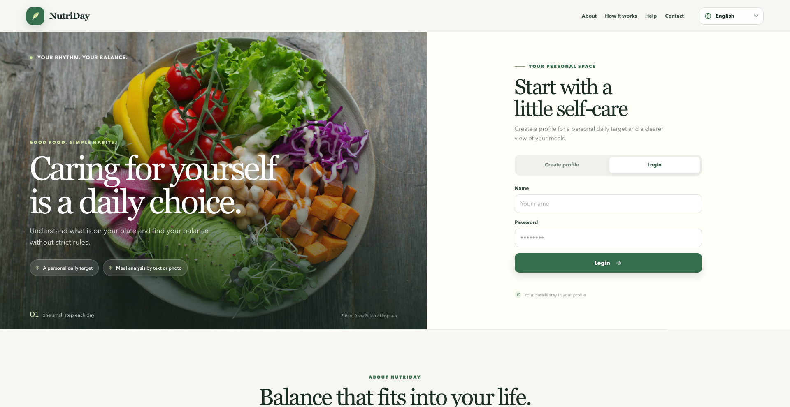
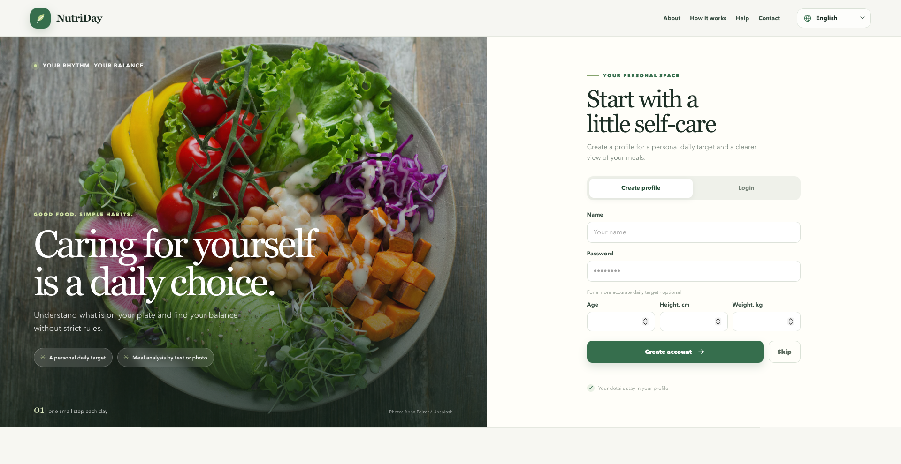
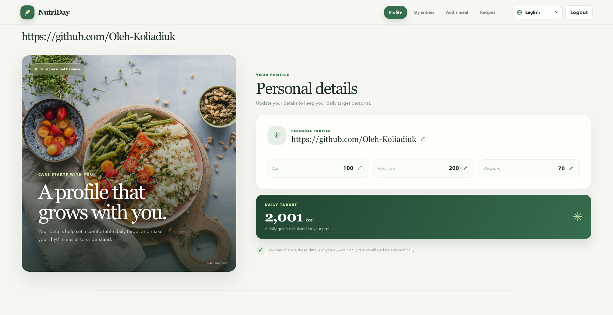
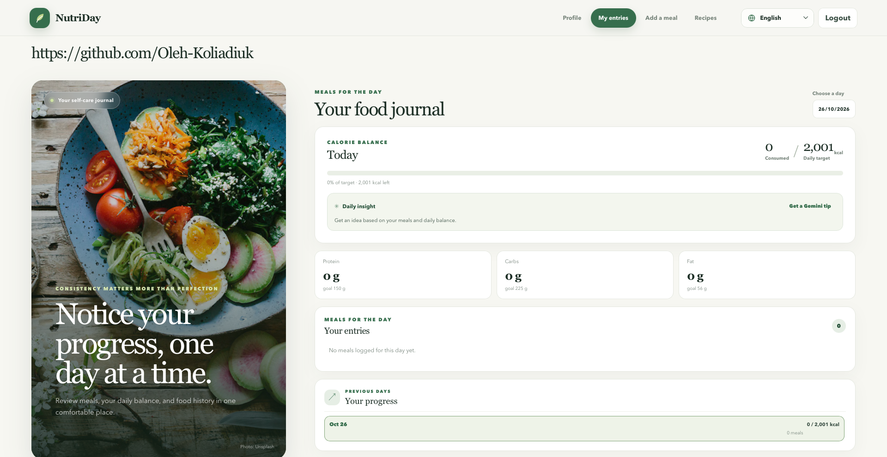
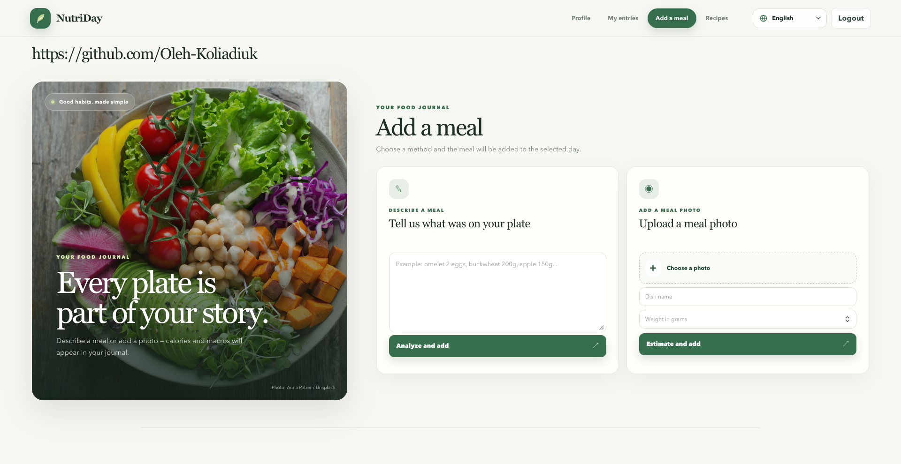
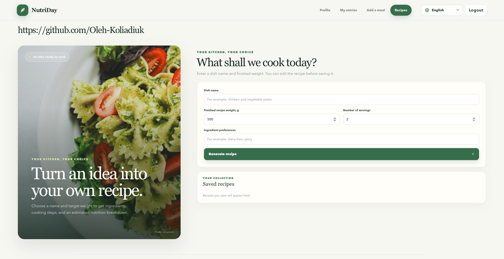

# NutriDay

NutriDay is a calorie and nutrition tracking web app. It combines a responsive HTML, CSS, and JavaScript frontend with a Python FastAPI backend and an SQLite database. Users can keep a meal diary, review nutrition over time, manage profile targets, and generate editable recipes.

## Features

- Account registration, sign-in, and a guest-style account with optional profile details.
- Editable profile name, age, height, and weight.
- Daily calorie and macronutrient targets. Targets are recalculated when profile measurements change.
- Meal logging from a text description or a food photo with a dish name and serving weight.
- Daily calorie and macronutrient summaries, meal history, and editing or deletion of meal entries.
- Daily nutrition suggestions based on the selected day's meals.
- Recipe generation from a dish name, target cooked weight, servings, and dietary preferences.
- An editable recipe form, including ingredients, quantities, instructions, and estimated nutrition; saved recipes can be updated or deleted.
- English, Ukrainian, and Russian interface translations. Recipe generation follows the selected language.
- Responsive pages for the profile, meal records, meal entry, and recipes, plus informational pages for About, Help, and Contacts.

Nutrition estimates are approximate and intended for general information, not medical diagnosis or treatment.

## Screenshots

### Sign in and create an account

| Sign in | Create account |
| --- | --- |
|  |  |

### Main app pages

| Profile | Meal entries |
| --- | --- |
|  |  |

| Add a meal | Recipes |
| --- | --- |
|  |  |

## AI integration

AI features use the **Google Gemini API**, through Google's google-genai Python SDK. The backend reads the API key from GEMINI_API_KEY; it is never needed in frontend JavaScript.

- Meal text analysis and food-photo analysis use gemini-3.8-flash.
- For temporary capacity errors, those calls retry and can fall back to gemini-3.1-flash-lite.
- Profile target calculation and daily insights also use Gemini when configured. Profile targets fall back to the built-in calorie-target calculator if Gemini is unavailable; daily insights have a local fallback.
- Recipe generation tries gemini-3.1-flash-lite first and then gemini-3.8-flash.

Set up a Gemini API key to enable AI meal analysis, image analysis, recipe generation, AI-assisted profile targets, and AI-generated daily suggestions. Without a key, the app still supports accounts, profile management, diary history, manual entry editing, and saved recipe management. AI-dependent operations that have no fallback return an unavailable result.

## Technology

- **Frontend:** HTML, CSS, and browser-native JavaScript ES modules; no frontend build step.
- **Backend:** Python, FastAPI, Pydantic, and SQLAlchemy.
- **Database:** SQLite by default.
- **AI:** Google Gemini API via google-genai.
- **Authentication:** bearer tokens; passwords are hashed with Argon2, with bcrypt verification compatibility.

## Requirements

- Python 3.10 or newer.
- A Gemini API key for AI features (optional).

## Setup

Create and activate a virtual environment from the project root, then install the backend dependencies:

    python -m venv .venv
    source .venv/bin/activate
    pip install -r backend/requirements.txt

On Windows, activate it with:

    .venv\Scripts\Activate.ps1

Create backend/.env:

    PROJECT_NAME=NutriDay
    DATABASE_URL=sqlite:///./data/calorie_tracker.db
    GEMINI_API_KEY=your_gemini_api_key

GEMINI_API_KEY is optional. Keep the real key private and do not commit .env files.

## Start the app

From the project root:

    cd backend
    uvicorn app.main:app --reload --host 127.0.0.1 --port 8000

Open http://127.0.0.1:8000. FastAPI serves index.html, the frontend modules, styles, and assets. The SQLite database and tables are created automatically at startup. The default database path is backend/data/calorie_tracker.db.

Useful backend URLs:

- /health — health check.
- /docs — interactive API documentation.

API endpoints use the /api prefix; see the route list below.

The frontend can also be opened with a static development server on port 5500; in that case it sends API requests to the FastAPI server on port 8000.

## API overview

Private routes require Authorization: Bearer <token>. Registration, login, skip signup, and the health check do not require an existing token.

| Method | Route | Purpose |
| --- | --- | --- |
| POST | /api/auth/register | Create an account |
| POST | /api/auth/login | Sign in and issue a token |
| POST | /api/auth/skip | Create an account with optional profile details skipped |
| GET | /api/auth/me | Get the current user's profile |
| PATCH | /api/auth/me | Update profile details and recalculate targets |
| GET | /api/nutrition/profile | Get daily nutrition targets |
| GET | /api/nutrition/day?day=YYYY-MM-DD | Get a day's summary and meal entries |
| GET | /api/nutrition/history | List days with recorded meals |
| POST | /api/nutrition/analyze-text | Analyze and save a meal from text |
| POST | /api/nutrition/analyze-image | Analyze and save a meal from an uploaded image |
| PATCH | /api/nutrition/meals/{meal_id} | Edit a meal entry |
| DELETE | /api/nutrition/meals/{meal_id} | Delete a meal entry |
| POST | /api/nutrition/insight?day=YYYY-MM-DD | Generate a daily nutrition suggestion |
| POST | /api/recipes/generate | Generate a recipe with Gemini |
| GET | /api/recipes | List saved recipes |
| POST | /api/recipes | Save a recipe |
| PATCH | /api/recipes/{recipe_id} | Update a saved recipe |
| DELETE | /api/recipes/{recipe_id} | Delete a saved recipe |

## Project structure

    .
    ├── index.html                  # Frontend entry point
    ├── assets/
    │   ├── favicon/                 # Browser and mobile app icons
    │   ├── screenshots/             # App screenshots used in this README
    │   └── site.webmanifest         # Installable web app metadata
    ├── css/
    │   ├── main.css                 # Shared layout and base styles
    │   ├── login.css                # Authentication pages
    │   ├── pages.css                # Dashboard and content pages
    │   └── decorations.css          # Decorative visual styles
    ├── js/
    │   ├── app.js                   # Frontend bootstrap and event setup
    │   ├── api.js                   # HTTP requests to the backend
    │   ├── auth.js                  # Registration and login UI
    │   ├── dashboard.js             # Page navigation and dashboard rendering
    │   ├── nutrition.js             # Meal entry and nutrition UI
    │   ├── recipes.js               # Recipe generation and saved recipes UI
    │   ├── i18n.js                  # Ukrainian, Russian, and English translations
    │   └── session.js               # Client-side session state
    └── backend/
        ├── app/
        │   ├── main.py              # FastAPI application and static file routes
        │   ├── api/                 # Authentication, nutrition, and recipe routes
        │   ├── core/                # Settings, security, and auth dependencies
        │   ├── database/            # SQLAlchemy base and database sessions
        │   ├── models/              # User, daily log, meal, and recipe tables
        │   ├── schemas/             # Pydantic request and response models
        │   └── services/            # Gemini integration, nutrition, and targets
        ├── data/                    # Local SQLite database (ignored by Git)
        ├── .env                     # Local secrets and configuration (not committed)
        └── requirements.txt         # Python dependencies

## License

NutriDay is available under the MIT License. See LICENSE.
